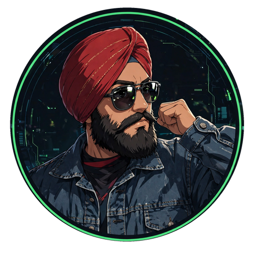
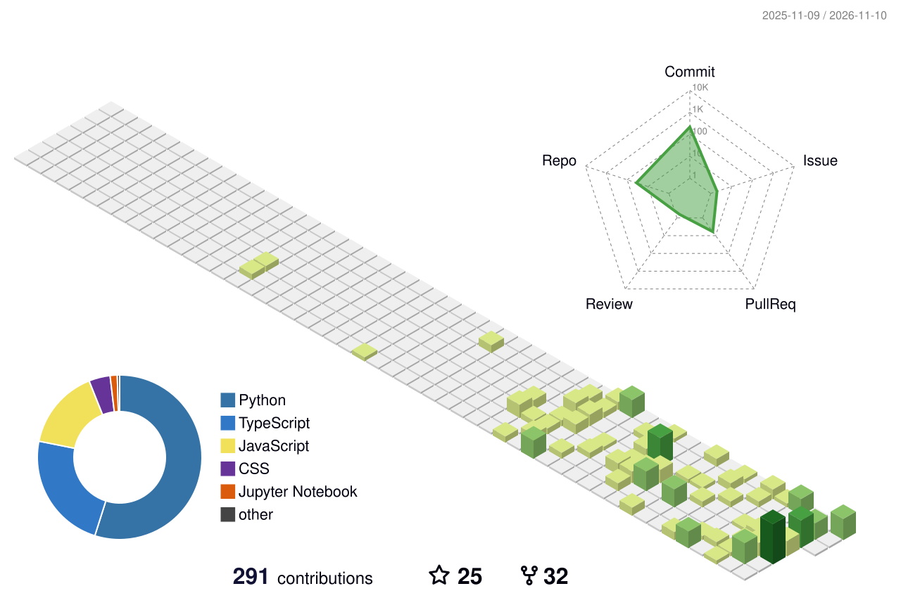

<p align="center">
  
</p>

<p align="center">💻 Building full-stack + AI-powered products · Exploring SaaS, automation & LLM tooling · Open to internships 🚀</p>

<p align="center">
  
  
  
</p>

### 🏙️ The city I built this year

<!-- The city image appears after you run the workflow once: Actions tab → "GitHub-Profile-3D-Contrib" → Run workflow. It rebuilds daily from your real contribution graph. -->

<p align="center">
  
</p>

<p align="center"><i>Every building is a day I shipped code — taller means more commits that day. A whole year of work, as a skyline. Rebuilt daily by GitHub Actions.</i></p>

### 🙋‍♂️ Who I Am

```typescript
const sidak = {
  title: "B.Tech CS Student (3rd Year)",
  role: "Full-Stack & AI Developer",
  location: "Shimla, Himachal Pradesh, India",
  stack: ["JavaScript", "TypeScript", "Python", "React", "Next.js", "Node.js"],
  currentlyBuilding: "Ledgerly — a zero-cost billing SaaS",
  launchedProjects: [
    "SehatSetu — multilingual AI symptom triage",
    "PermitGrow", "LawSaathi", "2Care.ai voice agent"
  ],
  status: "Actively seeking internships & placements 🎯",
  openTo: ["Internships", "Freelance", "Collaboration", "Full-time roles"],
};
```

### 🚀 Featured Projects

<p align="center">
  <a href="https://github.com/SidakSethi-Singh/sentry_intel"></a>
  <a href="https://github.com/SidakSethi-Singh/thermal-border-surveillance"></a>
</p>
<p align="center">
  <a href="https://github.com/SidakSethi-Singh/sehatsetu"></a>
  <a href="https://github.com/SidakSethi-Singh/LawSathi-Rag"></a>
</p>

| Project | What it is | Stack |
|---|---|---|
| **Sentry Intel** | AI open-source threat-intelligence dashboard | TypeScript, RAG, Groq |
| **Thermal Border Surveillance** | YOLOv8 person detection + ByteTrack, 98% precision, 60 FPS | Python, YOLOv8 |
| **SehatSetu** | Multilingual AI symptom triage with a deterministic red-flag rule engine | Next.js, Claude API |
| **LawSaathi** | RAG legal assistant over verified Indian legal sources | Python, RAG, NVIDIA NIM |
| **AgentProof** | Multilingual LLM agent evaluation harness (English / Hindi / Punjabi) | Python |
| **Ledgerly** | Zero-cost billing SaaS | Next.js, SQLite |
| **simplify-track-app** | React Native expense tracker | React Native, Expo |

### 🛠️ Tech Stack

**Languages**


**Frontend**


**Backend / Infra**


**Cloud / DB**


**AI / Dev Tools**


### 🔗 Connect With Me

<p align="center">
  <a href="https://github.com/SidakSethi-Singh"></a>
  <a href="https://www.linkedin.com/in/sidak-sethi-/"></a>
</p>


